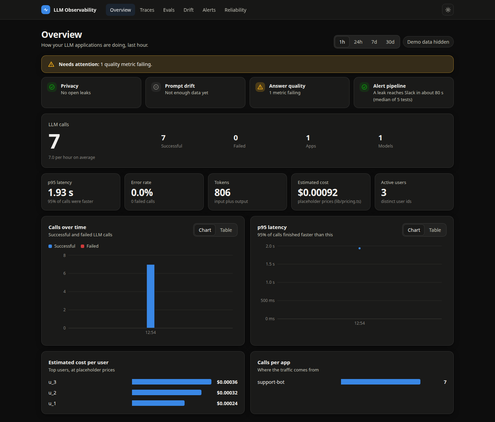
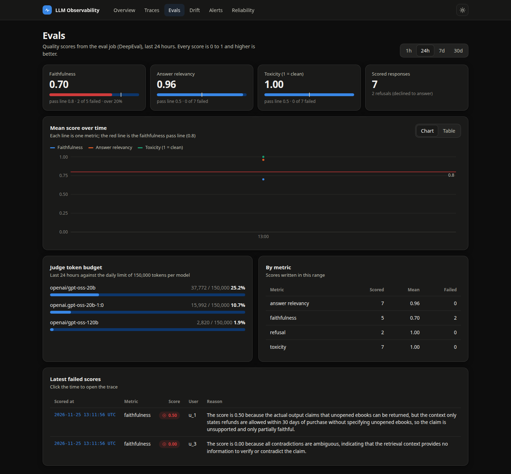
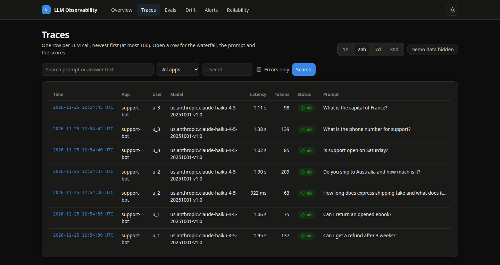
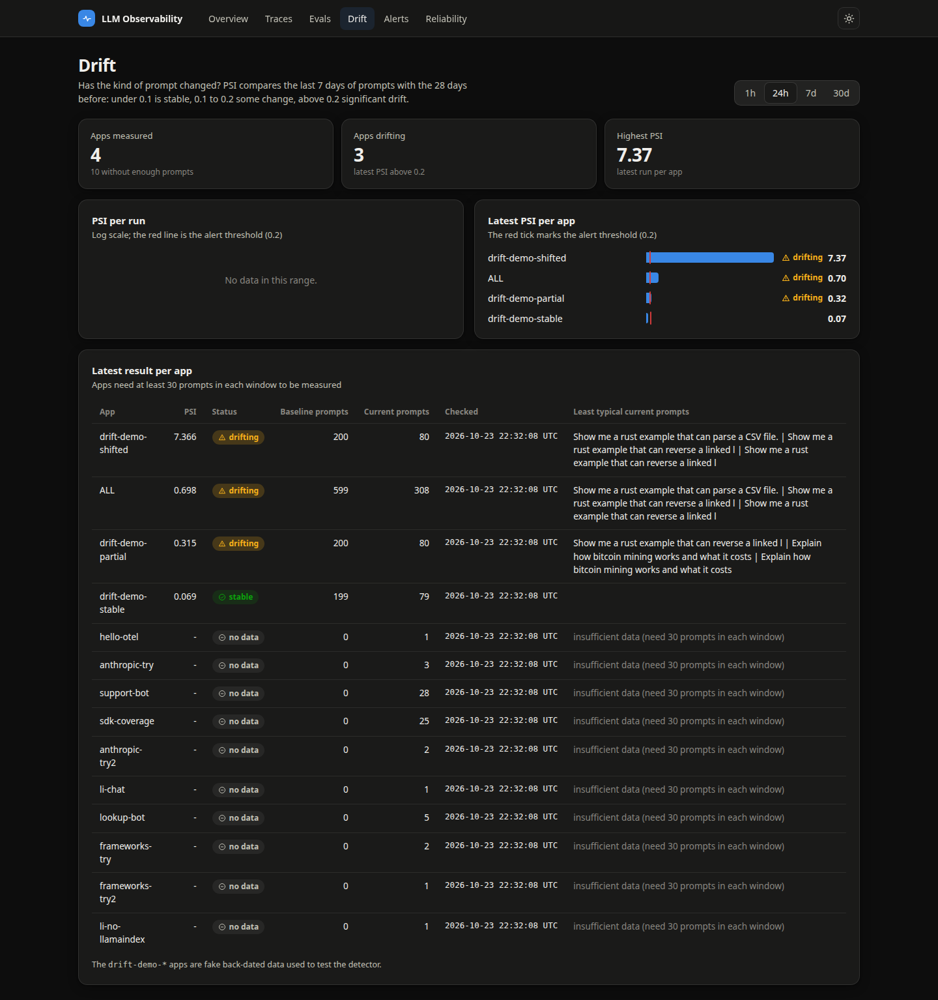
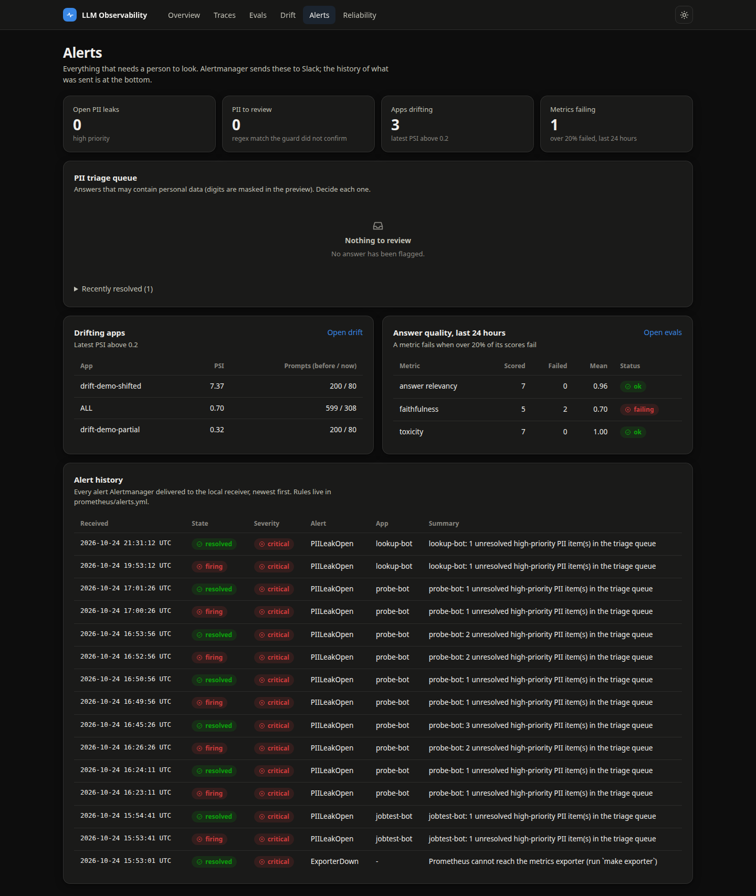
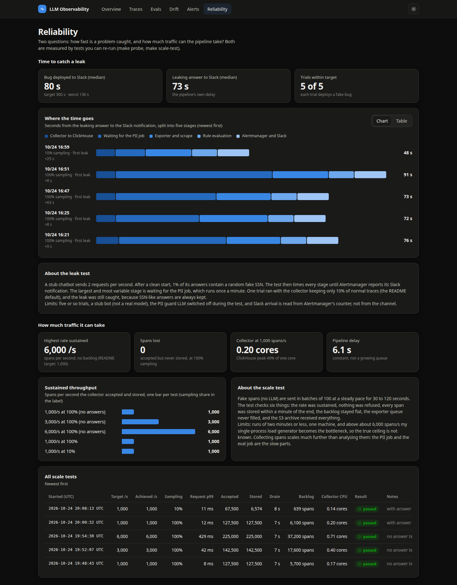
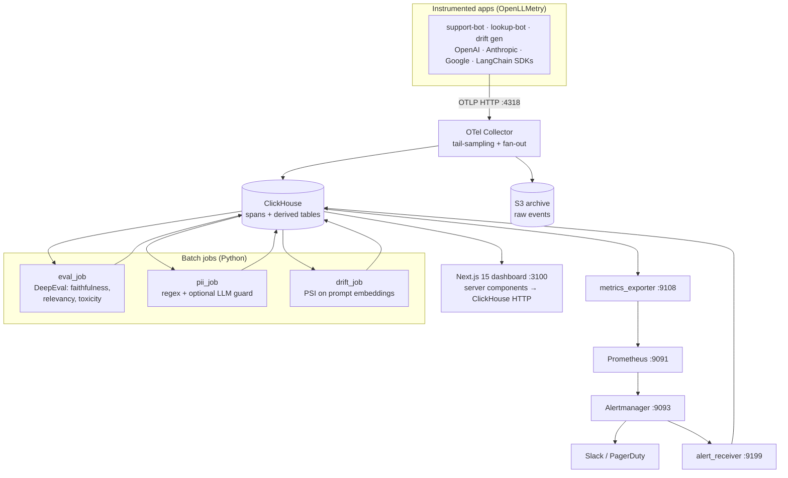

# LLM Observability & Eval Dashboard

A self-hosted observability plane for LLM applications: it ingests OpenTelemetry traces from
instrumented apps, stores them in ClickHouse, runs batch **eval / PII / drift** jobs over recent
traffic, and raises alerts — all surfaced in a Next.js dashboard. The headline test: a deliberately
injected regression (a bot that starts leaking fake SSNs) is caught and alerted in **under 5 minutes**.

Built as Capstone 11. The original brief is preserved at the [bottom of this file](#original-capstone-brief);
this README describes what was actually built.

---

## What it does

- **Ingest** GenAI-semconv spans over OTLP HTTP, tail-sample them (keep 100% of errors + anything
  that looks like a PII leak, 10% of the rest), and fan out to ClickHouse + an S3 archive.
- **Score answer quality** with DeepEval (faithfulness, answer-relevancy, toxicity) over the last
  15 minutes of traffic, writing scores back to ClickHouse.
- **Catch PII leaks** with a zero-token regex pass first, then an optional LLM guard, feeding a
  two-tier triage queue (open / review).
- **Detect prompt drift** with PSI on sentence-transformer embeddings of prompts, per app.
- **Alert** through Prometheus → Alertmanager → Slack / PagerDuty, and measure time-to-alert with a
  built-in regression probe.
- **Explore** everything — traces, cost per user, latency, eval trends, drift, alert history — in a
  Next.js 15 dashboard.

---

## Screenshots

**Overview** — calls, tokens, cost per user, latency, and a plain-language health row.



**Evals** — DeepEval scores with the judge's reasoning on failures (here, two faithfulness fails
where the bot made claims the context didn't support).



**Traces** — one row per LLM call; open a row for the waterfall, prompt, answer, and scores.



<details>
<summary>More screenshots — Drift, Alerts, Reliability</summary>

**Drift** — PSI per app over time against a trailing baseline.



**Alerts** — the firing/resolved history recorded by the local alert receiver, plus the PII triage queue.



**Reliability** — the regression-probe results: time from a deployed bug to a Slack alert.



</details>

---

## Architecture



**How it differs from the brief:** ClickHouse is the only datastore (no Postgres — users/apps/sessions
live as span attributes); evals are DeepEval + a custom PII judge (no RAGAS/Phoenix); and the SDK
coverage is OpenAI, Anthropic, Google, and LangChain via OpenLLMetry (LlamaIndex instrumentor is off,
vLLM untested). The traffic bot calls **Claude Haiku 4.5 on AWS Bedrock** through the native `converse`
API, with the span enriched by hand so the eval/PII/drift jobs get the tokens and prompt/answer text
they need.

---

## Stack

| Layer | Choice |
|---|---|
| Instrumentation | OpenTelemetry + OpenLLMetry (Traceloop), GenAI semantic conventions |
| Collector | OpenTelemetry Collector (contrib) with tail-sampling, exporting to ClickHouse + S3 |
| Storage | ClickHouse (spans and all derived tables); S3-mock for the raw-event archive |
| Evals | DeepEval (faithfulness, answer-relevancy, toxicity); LLM judge on an OpenAI-compatible endpoint (Groq `gpt-oss-20b` by default) |
| PII | Regex pass + optional LLM guard, two-tier triage queue |
| Drift | PSI on pooled prompt embeddings (`sentence-transformers`), 5 bins, per app |
| Alerting | Prometheus → Alertmanager → Slack / PagerDuty, plus a local receiver |
| UI | Next.js 15 (App Router, server components) + Recharts, reading ClickHouse over HTTP |

---

## Run it

Prereqs: Docker + Docker Compose, Python 3.13 with the project venv, Node for the dashboard, and a
`.env` (copy `.env.example`) with at least one LLM key.

```bash
make up && make schema        # start services, create tables
make traffic                  # send some traced LLM traffic (support bot → Claude Haiku on Bedrock)
make eval                     # score the recent answers with DeepEval
make pii                      # check recent answers for PII leaks
make drift                    # compute prompt drift (PSI)

make dashboard-install        # once
make dashboard                # http://127.0.0.1:3100

make start                    # exporter + alert receiver + PII loop (background)
make probe TRIALS=3           # inject the fake-SSN bug and time the Slack alert
make scale-test RATE=1000     # sustained-ingest check

make help                     # every command
```

All service ports bind to `127.0.0.1` only. See the [Makefile](Makefile) for the full list.

---

## Results

- **Regression MTTR:** a leaking answer reaches Slack in a **median of ~80 s** across test runs
  (target: under 5 minutes). The time breaks down across the collector, the PII loop tick, the
  exporter scrape, rule evaluation, and Alertmanager's group-wait.
- **Ingest scale:** sustained **1,000 spans/s** (and 3k / 6k in spot checks) with a flat backlog;
  the analysis jobs, not ingest, are the real bottleneck.
- **Eval behavior:** on a clean run of the support bot, answer-relevancy and toxicity pass across the
  board while faithfulness correctly fails the answers that assert facts the context doesn't support,
  and refusals ("I don't have that information") are detected and excluded from faithfulness.

---

